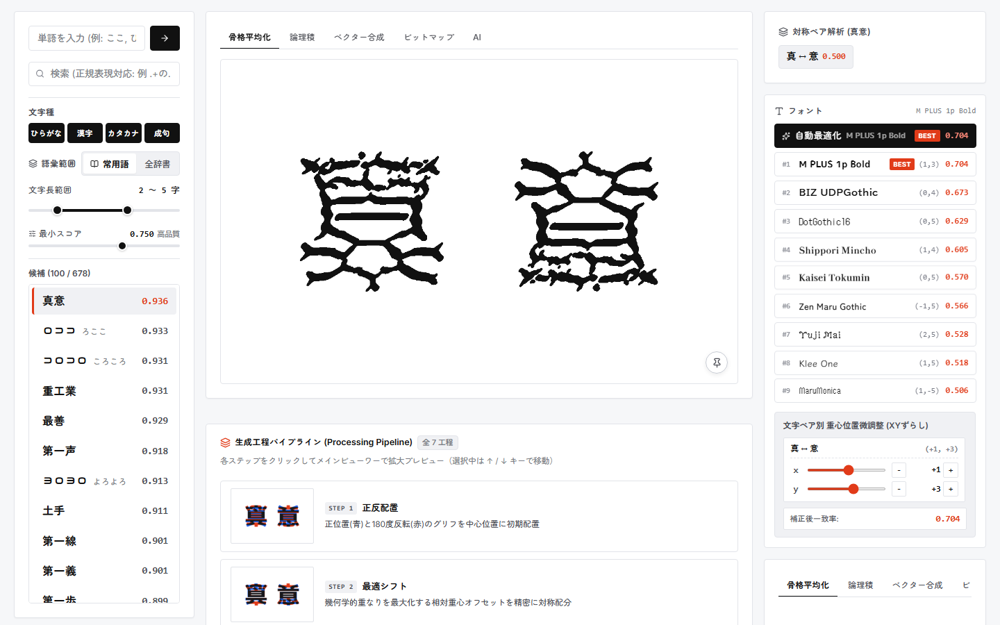
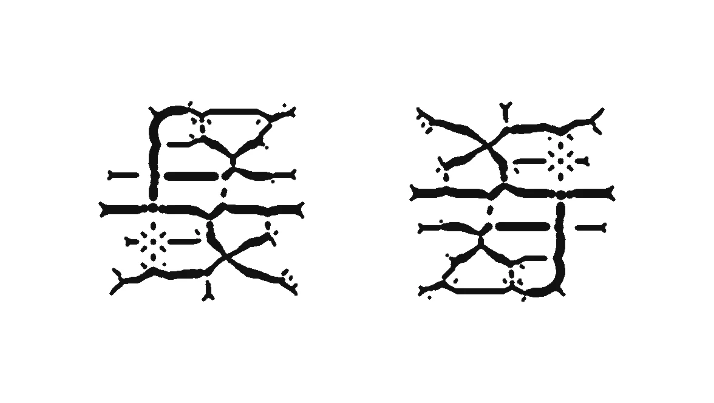
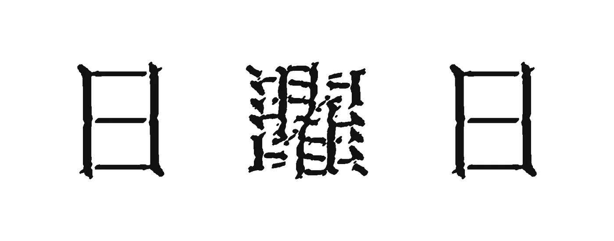
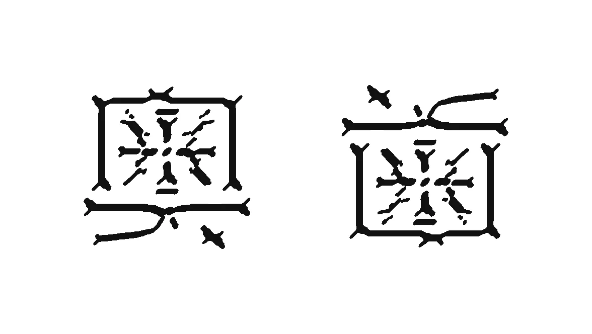
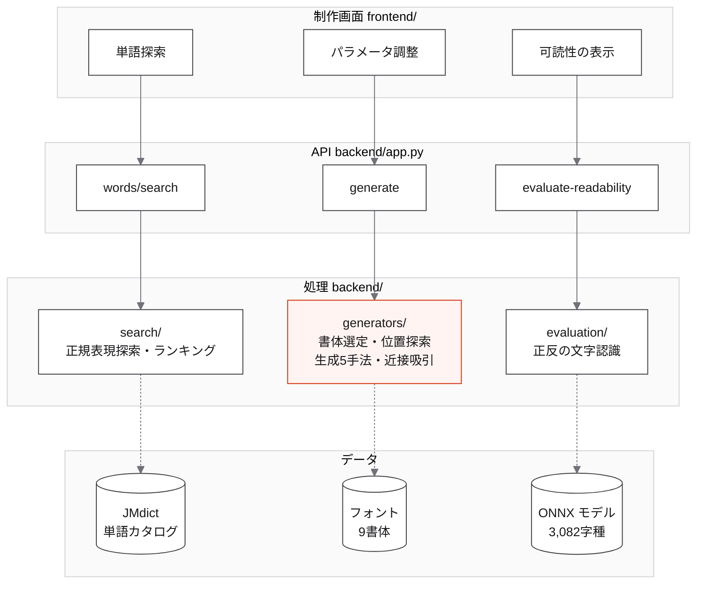
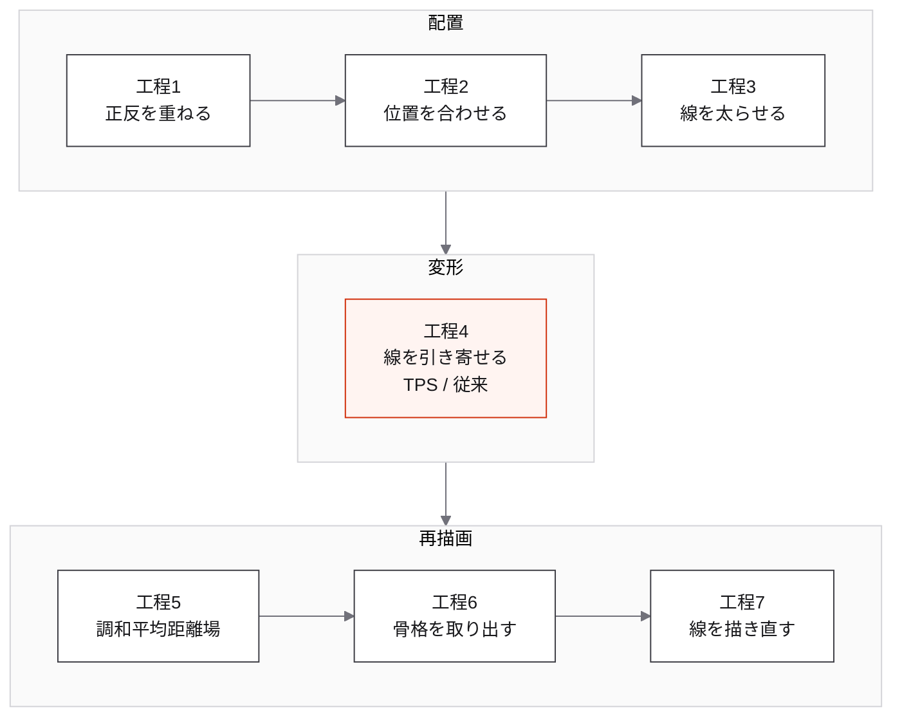
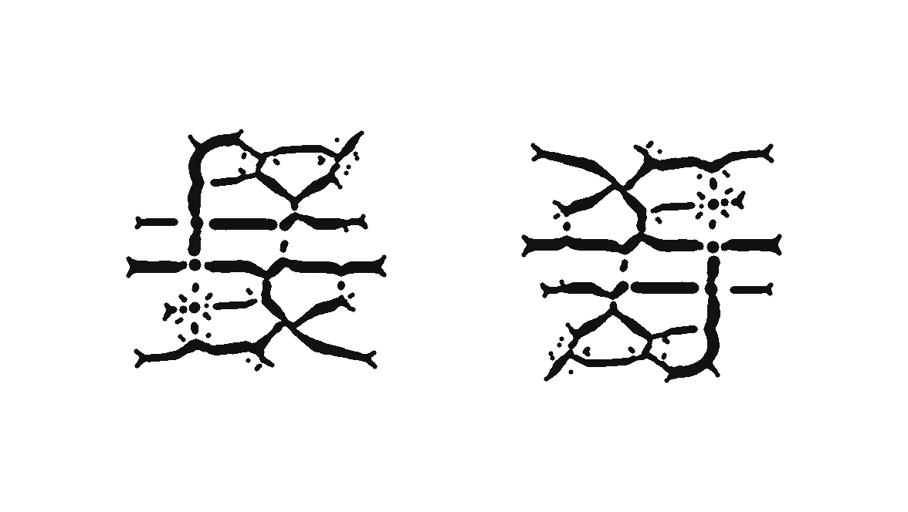
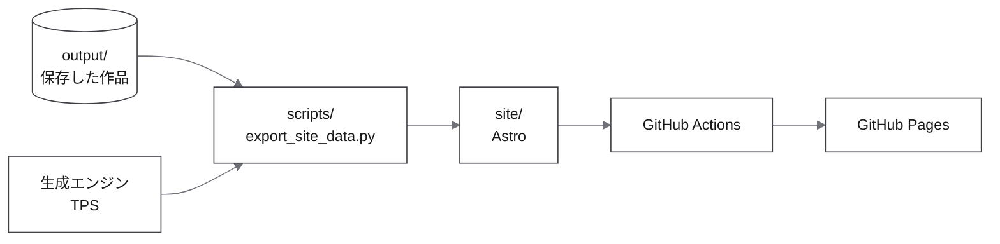

<div align="center">

# ambigram-maker

180度回転しても同じ単語として読める、日本語アンビグラムの制作支援システム

[](https://v76nl.github.io/ambigram-maker/) [](https://github.com/v76nl/ambigram-maker/actions/workflows/pages.yml) [](backend/pyproject.toml) [](backend/app.py) [](frontend/package.json) [](frontend/tsconfig.json) [](site/package.json) [](backend/evaluation/recognizer.py)

**[解説サイト](https://v76nl.github.io/ambigram-maker/)** · **[使い方](#5-実行方法)** · **[仕組み](#3-仕組み)**

<br>



</div>

<br>

## 目次

1. [概要](#1-概要)
2. [特徴](#2-特徴)
3. [仕組み](#3-仕組み)
4. [構造](#4-構造)
5. [実行方法](#5-実行方法)
6. [生成手法](#6-生成手法)
7. [評価](#7-評価)
8. [解説サイトの更新](#8-解説サイトの更新)
9. [先行研究読解リーダー](#9-先行研究読解リーダー)
10. [今後の展望](#10-今後の展望)
11. [クレジット](#11-クレジット)

## 1. 概要

アンビグラムの制作には、対になる文字の選定、重心の配置、線の融合といった職人的な試行錯誤が必要です。  
本システムは、辞書から成立しやすい単語を探し、書体と位置を自動で選んだうえで、2つの文字の線を1つの形に融合します。  
完全な自動生成を目指すのではなく、計算機が初期形状を示し、人が見ながらパラメータを調整して仕上げる制作支援ツールです。

<table>
  <tr>
    <td align="center"><br><sub>長寿</sub></td>
    <td align="center"><br><sub>日曜日</sub></td>
    <td align="center"><br><sub>奥歯</sub></td>
  </tr>
</table>

後半の文字は前半の文字を180度回転して作るため、完成した図形は必ず点対称になります。  
作例と生成の工程は、[解説サイト](https://v76nl.github.io/ambigram-maker/) でクリックして回しながら確認できます。

## 2. 特徴

- **正規表現による単語探索**  
  JMdict から作った20万語以上の辞書を、部分一致と正規表現 (例: `^.の.$`、`.*桜.*`) で探索します。  
  漢字語やカタカナ語も、ひらがなに変換せず本来の表記の文字ペアで評価します。
- **書体と位置の自動選定**  
  9書体のなかから文字ペアの重なりが最もよい書体を選び、XY方向のずらし量を全探索します。  
  文字ペアごとのずらし量は、画面のスライダーで微調整できます。
- **近接ストロークの吸引**  
  「の」の中央の線のように近くにある線どうしを、中間の対称軸へ引き寄せて1本にまとめます。  
  変形方式は、曲げエネルギーを最小化する薄板スプライン (TPS) と、従来のガウシアン平滑化から選べます。
- **毛筆調の再描画**  
  融合した形から骨格を取り出し、重なる部分は太く、片方だけの線は細く、楕円形の筆で描き直します。
- **生成工程の可視化**  
  各手法の中間画像を工程ごとに一覧表示し、クリックでメイン画面に拡大できます。
- **正反両方向の可読性評価**  
  同梱の文字認識モデル (ONNX、3,082字種) で、正位置と180度回転の両方向の認識確率を算出します。
- **作業の再現**  
  PNG・SVG画像と一緒に、書体、ずらし量、生成パラメータ、評価値をまとめた設定JSONを書き出せます。  
  JSONを読み込むと、同じ条件で作業を再開できます。
- **比較用のピン留め**  
  生成結果を画面下部に固定し、単語や書体を切り替えながら見比べられます。

## 3. 仕組み

### 3-1. システム構成

単語探索、生成、可読性評価の3つの流れが、それぞれ独立したAPIを通じて動きます。



### 3-2. 生成の工程 (骨格平均化)



<table>
  <tr>
    <td align="center"><br><sub>工程1 正反を重ねる</sub></td>
    <td align="center"><br><sub>工程4 線を引き寄せる</sub></td>
    <td align="center"><br><sub>工程5 調和平均距離場</sub></td>
    <td align="center"><br><sub>工程7 線を描き直す</sub></td>
  </tr>
</table>

灰色は正位置の文字、朱色は180度回転した文字、黒は両者の重なりです。

### 3-3. 技術スタック

| 領域 | 使用技術 |
| :-- | :-- |
| バックエンド | Python 3.13, FastAPI, Uvicorn, Pydantic |
| 画像処理 | NumPy, OpenCV, Pillow, fontTools, Shapely |
| 文字認識 | ONNX Runtime |
| AI生成 (任意) | Google Gen AI SDK (Imagen 3) |
| フロントエンド | TypeScript, React 19, Vite, Vanilla CSS |
| 解説サイト | Astro, GitHub Actions, GitHub Pages |
| 先行研究リーダー | HTML, CSS, JavaScript, KaTeX |
| パッケージ管理 | uv (Python), pnpm (Node.js) |

## 4. 構造

```text
ambigram-maker/
├── backend/
│   ├── app.py                      - FastAPI のエントリポイント
│   ├── cancellation.py             - 新しい要求が来たときに古い生成を中断する
│   │
│   ├── generators/                 - 生成手法
│   │   ├── base.py                 - 共通インターフェースと工程画像の変換
│   │   ├── font_manager.py         - 書体の選定、ずらし量の探索、単語スコアの算出
│   │   ├── snap_warper.py          - 近接ストロークの吸引 (TPS / ガウシアン平滑化)
│   │   ├── skeleton_engine.py      - 骨格平均化
│   │   ├── morphology_engine.py    - 論理積とモルフォロジー膨張
│   │   ├── vector_engine.py        - ベクター合成
│   │   ├── bitmap_engine.py        - ビットマップ最適化
│   │   └── gemini_engine.py        - 画像生成AI (Imagen 3)
│   │
│   ├── search/
│   │   ├── finder.py               - 正規表現探索とランキング
│   │   ├── rules.py                - ランキングの除外と補正
│   │   └── ranking_rules.json      - ランキング規則
│   ├── scoring/
│   │   ├── matrix.py               - ひらがなペアの相性行列と先行研究の実証ペア
│   │   └── compatibility.json      - 計算済みの相性行列
│   ├── dictionary/
│   │   ├── build_catalog.py        - JMdict から単語カタログを作る
│   │   ├── build_index.py          - 単語の事前スコア索引を作る
│   │   └── joyo_kanji.txt          - 常用漢字表
│   ├── evaluation/
│   │   ├── recognizer.py           - 正反両方向の文字認識
│   │   └── models/                 - ONNX モデルとラベル
│   │
│   ├── fonts/                      - 同梱フォント
│   └── tests/
│
├── frontend/
│   └── src/
│       ├── App.tsx
│       ├── components/             - 画面部品 (ビューア、工程表示、書き出しなど)
│       ├── hooks/                  - 生成パラメータと単語探索の状態
│       ├── services/api.ts         - バックエンドAPIのクライアント
│       ├── utils/configParser.ts   - 設定JSONの読み込み
│       └── constants/labels.ts     - パラメータ名と説明文
│
├── site/                           - 解説サイト (Astro)
│   ├── src/pages/index.astro
│   ├── src/pages/sitemap.xml.ts    - サイトマップ
│   ├── src/data/site-data.json     - 書き出した画像の一覧
│   ├── public/generated/           - 書き出した作例と工程画像
│   └── public/fonts/               - サイトで使う文字だけに絞った本文の書体
├── scripts/
│   ├── export_site_data.py         - 解説サイト用の画像と OGP 画像を書き出す
│   └── subset_site_font.py         - 本文の書体を、サイトで使う文字だけに絞る
│
├── research/
│   ├── reader/                     - 先行研究読解リーダー
│   ├── scholar_ambigram/           - 収集文献の書誌情報と要約
│   ├── scripts/                    - 文献メタデータの同期と監査
│   └── prior_research_insights.md  - 先行研究の整理
│
├── output/                         - 書き出した作品と設定JSON
├── slides/                         - 研究発表スライド (Marp)
├── docs/                           - 設計資料と予稿
│
├── .github/workflows/pages.yml     - 解説サイトの公開
├── run.py / run.bat                - バックエンドとフロントエンドの一括起動
└── test.py / test.bat              - テストの一括実行
```

## 5. 実行方法

Python 3.13、[uv](https://docs.astral.sh/uv/)、Node.js、[pnpm](https://pnpm.io/) が必要です。

```bash
git clone https://github.com/v76nl/ambigram-maker.git
cd ambigram-maker
pnpm install
pnpm --prefix frontend install
pnpm dev
```

起動後、ブラウザで `http://127.0.0.1:5173` を開きます。  
Python の依存パッケージは、初回起動時に uv が自動で入れます。

| コマンド | ディレクトリ | 実行内容 |
| :-- | :-- | :-- |
| `pnpm dev` | ルート | フロントエンド (5173) とバックエンド (8000) を一括起動 |
| `python run.py` / `run.bat` | ルート | 一括起動の別形態 |
| `uv run uvicorn app:app --port 8000 --reload` | `backend/` | バックエンドだけを起動 |
| `pnpm dev` | `frontend/` | フロントエンドだけを起動 |
| `pnpm test` | ルート | すべてのテストを実行 (pytest と Vitest) |
| `uv run pytest` | `backend/` | バックエンドのテスト |
| `pnpm test` | `frontend/` | フロントエンドのテスト |
| `pnpm --dir site dev` | ルート | 解説サイトを確認 (`http://127.0.0.1:4321/ambigram-maker/`) |
| `uv run --project backend python scripts/export_site_data.py` | ルート | 解説サイトの画像を書き出す |
| `uv run --with fonttools --with brotli python scripts/subset_site_font.py <NotoSansJP-VF.ttf>` | ルート | 解説サイトの本文の書体を、使う文字だけに絞り直す (`--check` で足りない文字を確認) |
| `python research/reader/serve.py` | ルート | 先行研究読解リーダーを起動 (8089) |
| `pnpm slides:serve` | ルート | 研究発表スライドを確認 (8080) |
| `pnpm slides:build` | ルート | スライドを HTML・PDF・PPTX に書き出す |

AI生成を使うときは、環境変数 `GEMINI_API_KEY` か画面の設定欄に API キーを入れます。

## 6. 生成手法

| 手法 | ファイル | 内容 |
| :-- | :-- | :-- |
| 骨格平均化 | `skeleton_engine.py` | 正反の文字の距離変換を調和平均し、その骨格を楕円形の筆で描き直す。重なる部分は太く、片方だけの線は細くする |
| 論理積 | `morphology_engine.py` | 正反の文字の重なり (論理積) を共通の核として取り出し、膨張と平滑化で線の太さと丸みを戻す |
| ベクター合成 | `vector_engine.py` | fontTools で取り出した輪郭を重ねる。正位置だけの部分と回転だけの部分を色分けして表示できる |
| ビットマップ | `bitmap_engine.py` | 正反の文字の重なりと差分のエネルギーを最適化する |
| AI | `gemini_engine.py` | Google の画像生成モデル Imagen 3 で生成する (API キーが必要) |

骨格平均化と論理積では、工程4で近接ストロークを吸引します。

- **TPS**  
  相手の線に近い骨格点を制御点、動かさない線と画像の外周を固定点とし、曲げエネルギーが最小になる変形を薄板スプライン (Bookstein, 1989) で解きます。  
  新しく作るときの既定の方式です。
- **従来**  
  骨格点の移動量をガウシアン平滑化で周囲へ広げます。  
  変形方式の記録がない設定JSONやAPI呼び出しは、この方式で再現されます。

## 7. 評価

- **文字ペアの幾何スコア**  
  正位置と180度回転した文字の一致度を、面積の重なり、骨格の重なり、余白 (ふところ・穴) の重なりの3つで評価し、重み付きで合成します。  
  線の太い書体で偶然の重なりが過大に評価されないよう、重なりの期待値を差し引いて補正します。
- **先行研究の実証ペア**  
  ひらがなのペアには、井上・高橋 (2020) の可読性実験などをもとにした62組の実証ペアを反映し、読めたペアを高く、読めなかったペアを低く評価します。
- **単語スコア**  
  文字ペアのスコアの幾何平均と最小値を合成します。  
  井上・高橋 (2020) で、1文字が読みにくくても単語としては読める場合が多いと報告されていることから、単語が長く全体の一致度が高いほど、最小値の重みを下げます。  
  重みの式は本プロジェクトで設定したもので、論文で提案されたモデルではありません。
- **正反両方向の可読性**  
  同梱の文字認識モデル (JIS第1水準漢字、ひらがな、カタカナの3,082字種) で、正位置と180度回転の両方向の認識確率を求め、その調和平均を可読性とします。  
  現在の評価は画面の吸引設定を反映せず、既定の設定で生成した画像を評価します。

## 8. 解説サイトの更新

解説サイトは、`main` に `site/` の変更を push すると GitHub Actions でビルドされ、GitHub Pages に公開されます。



- **作例を差し替える**  
  制作画面で作品と設定JSONを `output/` に書き出し、`scripts/export_site_data.py` の `GALLERY_WORDS` に単語を追加して、書き出しを実行します。
- **工程画像を差し替える**  
  `PIPELINE_WORDS` と `SNAP_WORD` を変えて、書き出しを実行します。
- **中心線の閾値の比較を差し替える**  
  `THRESHOLD_WORD` と `THRESHOLD_LEVELS` を変えて、書き出しを実行します。  
  相性の重みの節は、`GALLERY_WORDS` の単語の文字ペアごとに3つの要素の値を書き出し、ブラウザで重みを掛けて点数を計算し直します。
- **文章を書き換える**  
  本文の書体はサイトで使う文字だけを収録しているため、文章を変えたら `scripts/subset_site_font.py` で書体を作り直します。  
  Noto Sans JP の可変フォント (`NotoSansJP-VF.ttf`) を引数に渡します。収録していない文字は、閲覧環境の書体で表示されます。
- **サイトマップ**  
  `https://v76nl.github.io/ambigram-maker/sitemap.xml` に出力されます。
- **載せないもの**  
  未発表の評価スコアと、第三者論文の本文・図版は載せません。

## 9. 先行研究読解リーダー

先行研究の数式と、本リポジトリの実装コードを対応づけて読むためのビューアです。  
論文の本文と図版は著作権に配慮してリポジトリに含めておらず、手元にデータがある環境でだけ表示できます。  
データがない環境では、アプリ実装の解説だけを閲覧できます。

起動は `python research/reader/serve.py` を実行し、`http://localhost:8089/` を開きます。

## 10. 今後の展望

離散的なグラフ照合の計算量とラスター画像の解像度の限界を越えるため、[v76nl/ambigram-maker#6](https://github.com/v76nl/ambigram-maker/issues/6) で次の構成を検討しています。

- **微分可能レンダラー (DiffVG) によるベクター最適化**  
  ベジェ曲線の制御点と線幅を、勾配降下法で直接最適化します。
- **拡散モデルによる対称誘導**  
  180度回転した潜在変数を並行してノイズ除去し、毛筆のかすれのような表現を生成します。
- **VectorFusion 型の組み合わせ**  
  ベクター表現を、拡散モデルと文字認識器の損失で最適化します。

## 11. クレジット

### 辞書

[JMdict](https://www.edrdg.org/wiki/index.php/JMdict-EDICT_Dictionary_Project) © Electronic Dictionary Research and Development Group ([CC BY-SA 4.0](https://www.edrdg.org/edrdg/licence.html))

### 同梱フォント

`backend/fonts/` と `frontend/public/fonts/` のフォントは、各作者のライセンスに基づいて同梱しています。  
SIL Open Font License の全文は [`backend/fonts/OFL.txt`](backend/fonts/OFL.txt) にあります。

| フォント | スタイル | 著作権表示 | 配布元 | ライセンス |
| :-- | :-- | :-- | :-- | :-- |
| Zen Maru Gothic | 丸ゴシック | Copyright 2021 The Zen Maru Gothic Project Authors | [googlefonts/zen-marugothic](https://github.com/googlefonts/zen-marugothic) | [SIL OFL 1.1](https://openfontlicense.org/) |
| M PLUS 1p (Bold) | 角ゴシック | Copyright 2020 The M+ FONT PROJECT Authors | [coz-m/MPLUS_FONTS](https://github.com/coz-m/MPLUS_FONTS) | [SIL OFL 1.1](https://openfontlicense.org/) |
| Klee One (SemiBold) | 硬筆 | Copyright 2020 The Klee Project Authors (Fontworks Inc.) | [fontworks-fonts/Klee](https://github.com/fontworks-fonts/Klee) | [SIL OFL 1.1](https://openfontlicense.org/) |
| Shippori Mincho (Bold) | 明朝 | Copyright 2020 The Shippori Mincho Project Authors (FONTDASU) | [fontdasu/ShipporiMincho](https://github.com/fontdasu/ShipporiMincho) | [SIL OFL 1.1](https://openfontlicense.org/) |
| BIZ UDPGothic (Bold) | UDゴシック | Copyright 2022 The BIZ UDGothic Project Authors (Morisawa Inc.) | [googlefonts/morisawa-biz-ud-gothic](https://github.com/googlefonts/morisawa-biz-ud-gothic) | [SIL OFL 1.1](https://openfontlicense.org/) |
| Yuji Mai (Regular) | 毛筆 | Copyright 2020 The Yuji Project Authors (Kinuta Font Factory) | [googlefonts/yuji](https://github.com/googlefonts/yuji) | [SIL OFL 1.1](https://openfontlicense.org/) |
| Kaisei Tokumin (Bold) | モダン明朝 | Copyright 2020 The Kaisei Project Authors (FONT-KAISEI) | [googlefonts/kaisei](https://github.com/googlefonts/kaisei) | [SIL OFL 1.1](https://openfontlicense.org/) |
| DotGothic16 (Regular) | ドット | Copyright 2020 The DotGothic16 Project Authors (Fontworks Inc.) | [fontworks-fonts/DotGothic16](https://github.com/fontworks-fonts/DotGothic16) | [SIL OFL 1.1](https://openfontlicense.org/) |
| MaruMonica | 丸ピクセル | 患者長ひっく (hicc / x0y0pxFreeFont) | [BOOTH: x0y0pxFreeFont](https://x0y0px.booth.pm/) | フリー (商用・埋め込み可) |

### 関連ドキュメント

- [`docs/ISSUES.md`](docs/ISSUES.md): 剛体回転の幾何的な限界と、近接ストロークの吸引による解決の検討
- [`docs/OPTIMIZATION_PIPELINE.md`](docs/OPTIMIZATION_PIPELINE.md): 書体とずらし量の探索パイプラインの設計
