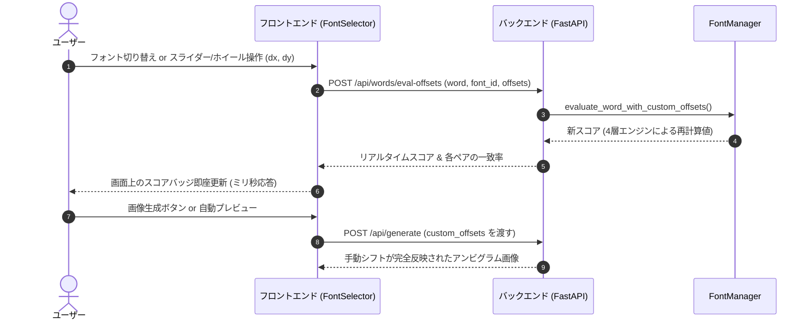

# 最適フォント・パラメータ探索システム仕様書 (Optimization Pipeline)

本ドキュメントでは、本システム（ambigram-maker）が入力された単語に対して**最も幾何対称性・可読性の高いフォントを選定し、最適な座標シフト（XYオフセット）および画像生成パラメータを自動探索・決定する仕組み**を、処理の流れ（パイプライン順）に沿って解説します。

---

## 処理フロー全体像 (Architecture Flowchart)

```mermaid
flowchart TD
    A[ユーザー入力単語 (例: '同国')] --> B[Step 1: 単語の構造分解と文字ペア化]
    B --> C[Step 2: 5種フォントのレンダリング & 適応的前処理]
    C --> D[Step 3: 4層幾何類似度エンジンによる評価]
    
    subgraph Engine4 [4層幾何類似度エンジン]
        D1[1. 適応的 Pre-Bold スリット保護]
        D2[2. 骨格スケルトン Chamfer交差率]
        D3[3. 負の空間 ふところ・穴の整合性]
        D4[4. 偶然重なり期待値補正 Chance-Adjusted IoU]
    end
    D --> Engine4
    Engine4 --> E[Step 4: 2次元座標揺らし Micro-Shift 全探索]
    
    E --> F[Step 5: 単語総合スコアリング & 最適フォント決定]
    F --> G[Step 6: 各生成エンジンへの最適パラメータ配分 & 描画]
    G --> H[Step 7: UIリアルタイム再計算ループ (手動微調整)]
```

---

## ステップ別詳細解説

### Step 1: 単語の構造分解と文字ペア化

単語が与えられると、自己回転180度アンビグラムの幾何学的成立条件に基づいて文字列を対称ペアに分割します。

- **単語長 $N$ の分割ロジック**:
  - 対象文字ペア数: $K = \lfloor (N + 1) / 2 \rfloor$
  - 偶数文字（例: 「同国」$N=2$）:
    - ペア 1: 1文字目「同」 $\leftrightarrow$ 2文字目「国」の180度反転
  - 奇数文字（例: 「ここ」$N=3$）:
    - ペア 1: 1文字目「こ」 $\leftrightarrow$ 3文字目「こ」の180度反転
    - ペア 2: 2文字目「の」 $\leftrightarrow$ 2文字目「の」自転対称性（自己中心回転）
- **文字種横断対応**:
  - ひらがなだけでなく、漢字・カタカナも本来の表記文字のまま処理します。

---

### Step 2: 5種フォントのレンダリング & 適応的前処理 (Adaptive Pre-processing)

現在利用可能な 5 種類の高品質オープンソース書体に対し、各文字を $128 \times 128$ ピクセルの 2 値マトリクスとして描画します。

- **利用書体プリセット**:
  1. `zen_maru`: Zen Maru Gothic (丸ゴシック、太さ均一・親和性高)
  2. `dela_gothic`: Dela Gothic One (極太フラット見出し)
  3. `m_plus_1p`: M PLUS 1p Bold (幾何学的角ゴシック)
  4. `klee`: Klee One SemiBold (硬筆ペン字体・線の抑揚)
  5. `shippori`: Shippori Mincho Bold (明朝体・筆画の起筆・終筆)
- **適応的 Pre-Bold（太らせ処理の密度連動）**:
  - **課題**: 通常フォントは微小なストロークのズレを吸収するために膨張（`cv2.dilate`）が有効ですが、Dela Gothic 等の極太フォントに一律膨張をかけると、文字内の隙間（スリット・ふところ）が黒潰れして四角いベタ塗りブロックと化し、非対称な文字でも異常に高いスコアが出てしまいます。
  - **解決策**:
    - 文字の生の黒画素充填率 $\text{density}$ を計測。
    - `font_id == "dela_gothic"` または $\text{density} > 0.26$ の場合、**膨張処理を自動バイパス（スキップ）**。
    - これにより、Dela Gothic の文字本来のシャープな空隙・スリットを完全に保護します。

---

### Step 3: 4層幾何類似度エンジンによる対称性・可読性評価

正位置画像 $A$ と 180 度回転画像 $B_{\text{rot}}$ に対し、人間の文字認識・可読性に直結する **4つの数学的指標** を算出してブレンドします。

```
総合幾何スコア = 0.45 × 面積一致度(補正後) + 0.35 × 骨格スケルトン一致度 + 0.20 × 負の空間(穴)一致度
```

#### ① 面積一致度 & 偶然重なり期待値補正 (Chance-Adjusted IoU)
- **課題**: 黒画素が多いフォントほど、形状が無関係でも中央部が偶然重なり合い、高いスコアの下駄を履く（Chance Overlap）。
- **数式**:
  文字外接矩形（ROI）の面積を $S_{\text{roi}}$、各文字の黒画素密度を $p_A, p_B$ としたときの偶然重なり期待値 $E[\text{IoU}]$:
  $$E[\text{IoU}] = \frac{p_A \cdot p_B}{p_A + p_B - p_A \cdot p_B}$$
  正味の構造的一致度（Adjusted IoU）:
  $$\text{IoU}_{\text{adj}} = \max\left(0, \frac{\text{IoU}_{\text{raw}} - E[\text{IoU}]}{1 - E[\text{IoU}]}\right)$$
  調和被覆率（Harmonic Coverage: 双方の線が互いをカバーする度合い）と合成:
  $$\text{Score}_{\text{area}} = 0.50 \times \text{IoU}_{\text{adj}} + 0.50 \times H_{\text{cov}}$$

#### ② 骨格構造（細線化スケルトン）交差率
- **手法**:
  - 文字の肉付け（ストローク幅）を剥ぎ取り、1px のストローク中心線（骨格）を抽出（OpenCV `thinning`）。
  - 許容距離（5x5 楕円カーネルによる膨張領域）内における骨格線同士の相互被覆率（Chamfer-like Coverage）を計算。
- **効果**: フォントの太さに関係なく、「線のトポロジー（画数・方向・交差）」が180度対称になっているかを厳密に判定。

#### ③ 負の空間（Negative Space・ふところ・穴・開口部）の整合性
- **手法**:
  - 文字外接矩形（ROI）内における「白画素（穴・空隙）」の論理積と論理和を算出:
    $$\text{Score}_{\text{neg}} = \frac{\sum (\text{White}_A \cap \text{White}_B)}{\sum (\text{White}_A \cup \text{White}_B)}$$
- **効果**: 人間の文字認識において決定的な役割を果たす「文字の穴（例: 日の中央、国の中の空隙）」の位置が合っていない非対称ペアを強烈に減点。

---

### Step 4: 2次元座標揺らし (Micro-Shift 全探索) による最適オフセット探索

人間のアンビグラムデザインでは、文字同士をわずかに上下左右にずらすことで、劇的に一致率が向上します。システムはこの調整を自動全探索します。

- **探索範囲**:
  - 水平方向: $\Delta x \in \{-5, -4, \dots, +5\}$
  - 垂直方向: $\Delta y \in \{-5, -4, \dots, +5\}$
  - 計 $11 \times 11 = 121$ 通りの配置を全数探索。
- **高速化の工夫**:
  - 探索ループの内部で重い画像処理を行わないよう、`skel_a` の膨張画像や `skel_b` の 180 度回転・膨張画像を**ループ外で事前生成**。
  - ループ内はスライス取得と内積計算のみに限定し、121 通りの評価を数ミリ秒で完了。
- **結果**:
  - 最もスコアが高くなる座標シフト $(\Delta x^*, \Delta y^*)$ と、そのときの最高スコア $S_{\text{pair}}^*$ を獲得。

---

### Step 5: 単語総合スコアリング & 最適フォント決定

全文字ペアの最高スコア $S_1, S_2, \dots, S_K$ から、単語全体のアンビグラムスコアを算出します。

- **ボトルネック重視の調和型統合式**:
  $$\text{Score}_{\text{word}} = 0.75 \times \left( \prod_{i=1}^K S_i \right)^{1/K} + 0.25 \times \min(S_1, \dots, S_K)$$
  - 幾何平均（Geometric Mean）により、1文字でも破綻している単語を厳しく抑制。
  - ボトルネック最小値（Min Score）を 25% 加味することで、「最も読みにくい文字ペア」の品質を保証。
- **最適フォントの自動選出 (Auto-Optimizer)**:
  - 5 つのフォント候補の単語総合スコアを比較し、**最も高得点となったフォント（およびその各文字ペアの最適 XY シフト）** をデフォルトの最適フォントとして自動選定。

---

### Step 6: 生成エンジン固有パラメータの最適化

選定されたフォントと最適オフセットに基づき、各生成エンジンが最適な描画パラメータを自動適用して画像を生成します。

| エンジン | 特徴 | 自動適用される最適パラメータ |
| :--- | :--- | :--- |
| **手法A: 論理積＋モルフォロジー (`morphology_engine.py`)** | 正反ピクセルの積（AND）を核とし、二重線・ゴーストを解消した丸みのある単一ストローク | - `dilation_size`: 11px（ストローク接続膨張）<br>- `diff_blend`: 0.35（固有差分の半透明ブレンド率）<br>- `custom_offsets`: Step 4 で求めた最適 $(\Delta x, \Delta y)$ |
| **手法B: スケルトン平均化 (`skeleton_engine.py`)** | 調和平均距離場から中心骨格を抽出し、均一ブラシで一本化 | - `stroke_thickness`: 15px（均一ブラシ幅）<br>- `diff_blend`: 0.35<br>- `custom_offsets`: Step 4 で求めた最適 $(\Delta x, \Delta y)$ |
| **原案: ベクター幾何合成 (`vector_engine.py`)** | FontTools による SVG アウトライン重ね合わせとパーツ色分け | - `blend_ratio`: 0.5<br>- `custom_offsets`: Step 4 で求めた最適 $(\Delta x, \Delta y)$ |

---

### Step 7: インタラクティブ微調整とリアルタイム再計算ループ

画面右ペインの Typography カードおよび微調整スライダーにより、ユーザーはリアルタイムにパラメータを探索・確認できます。



- **ホイールスクロール対応**: スライダー上にマウスを乗せてホイールを上下させるだけで、$\pm 1\text{px}$ 単位で滑らかに微調整可能。
- **即時スコア再計算**: シフトを動かすたびに `POST /api/words/eval-offsets` が走り、新スコアがリアルタイムにフィードバックされます。
